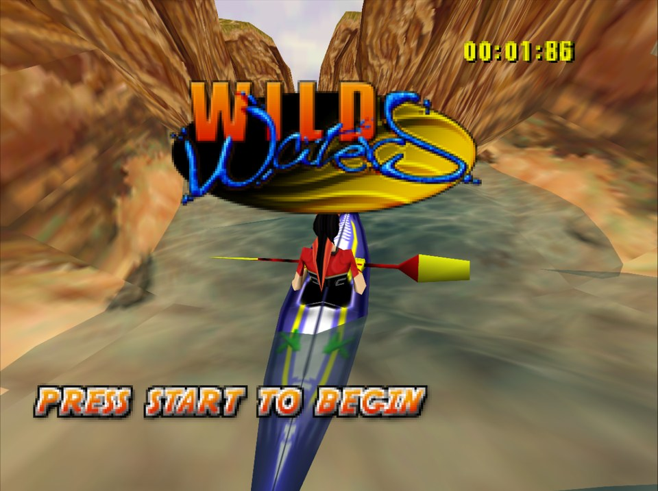
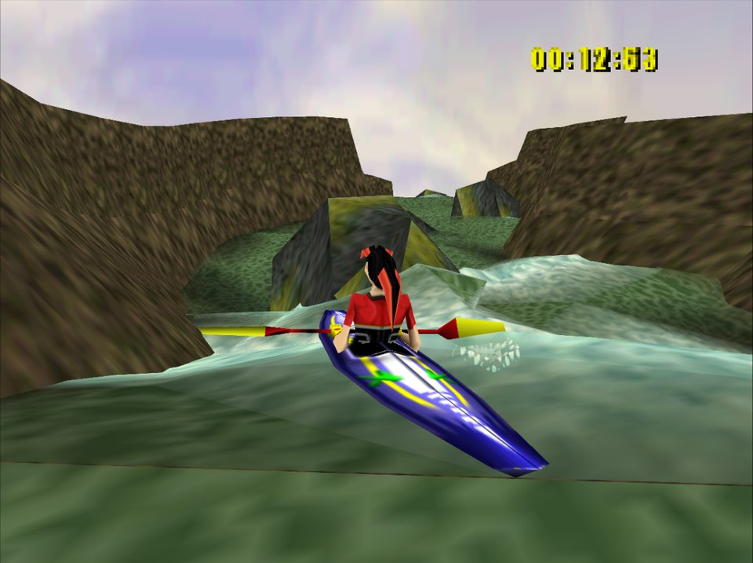
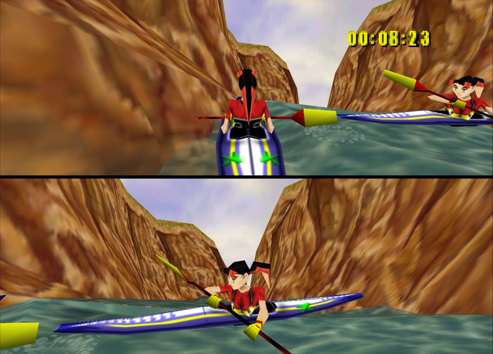

# WildWaters PC

A native Windows port of **WildWaters** (also known as *Extreme Kayak* / *X-Stream*), the unreleased
Nintendo 64 kayak racer by Looking Glass Studios, made from the **June 15, 1999 prototype**.

The game's N64 code is statically recompiled into a 64-bit Windows program
([N64Recomp](https://github.com/N64Recomp/N64Recomp) +
[N64ModernRuntime](https://github.com/N64Recomp/N64ModernRuntime)); graphics are drawn with
[RT64](https://github.com/rt64/rt64) on DirectX 12, so it runs at any resolution and in widescreen.

| Title demo | Woodchuck Ridge | Two players |
|---|---|---|
|  |  |  |

## What's in it

- **Both courses playable.** The prototype's second course, Woodchuck Ridge, was cut off on the
  development cartridge (its last river section and collision data never made it into the first
  8 MB). The port rebuilds the missing data, so the course loads and plays.
- **Correct speed.** The race runs at the game's intended 30 frames per second, with a working timer.
- **Restored title demo.** The prototype has a "PRESS START TO BEGIN" attract screen that it never
  shows: leave the menus idle for 30 seconds and a demo race plays under the logo.
- **"YOU SURVIVED!" at the finish.** The prototype has the banner but no finish line; the port shows
  it at the end of each course.
- **Music options** (Settings > Sound): the prototype's own race music, the songs left unplayed in
  the ROM, or the Destruction Derby 64 music left on the cartridge.
- **Two players**, split screen: turn on Settings > General > Two-player mode, then assign the
  controllers in Settings > Controls.
- **Any controller**: PlayStation 4/5, Xbox, Switch Pro, Joy-Cons, GameCube adapters, N64-style pads
  and adapters for real N64 controllers, Steam and many more; unknown pads get a standard layout that
  can be rebound.
- Widescreen, high resolutions, MSAA and more in Settings > Graphics.

## Installing

1. Download **WildWaters-PC-Setup.exe** from the [releases](https://github.com/kingzmanh/wildwaters-pc/releases).
2. Run it and choose **your own copy** of the WildWaters ROM: the June 15, 1999 prototype
   (16 MB, MD5 `b867880c96c9e8d3130dde5526c95439`; `.z64`, `.v64` or `.n64` all work).
   The ROM is not included.
3. Pick a folder and press Install. Settings, saves and the game's ROM copy stay in that folder.

Press **Esc** in the game for the settings.

## Building from source

Needs Visual Studio 2022 or later (C++ x64 tools), CMake, Ninja and Python 3 (with Pillow and
NumPy for the tools), plus checkouts of N64Recomp, N64ModernRuntime, RT64 and RecompFrontend in a
folder passed as `N64_TOOLS` (default: `../../Tools/N64 tools`).

1. Put your ROM next to this file as `baserom.z64`.
2. `N64Recomp wildwaters.toml` and `RSPRecomp recomp/aspMain.toml` (generates `RecompiledFuncs/`).
3. `build.cmd` builds the game into `host/build-win/` (`build.cmd headless` builds the test version).
4. `build_setup.cmd` builds `dist/WildWaters-PC-Setup.exe`.

Technical notes on the port, the ROM layout and everything found in it are in [NOTES.md](NOTES.md).

## Credits

- **WildWaters** by Looking Glass Studios.
- [N64Recomp](https://github.com/N64Recomp/N64Recomp), [N64ModernRuntime](https://github.com/N64Recomp/N64ModernRuntime),
  [RT64](https://github.com/rt64/rt64) and RecompFrontend by Mr-Wiseguy, Dario and contributors.
- [SDL](https://www.libsdl.org/), [SDL_GameControllerDB](https://github.com/mdqinc/SDL_GameControllerDB)
  and [xxHash](https://github.com/Cyan4973/xxHash).
